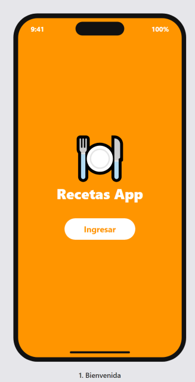
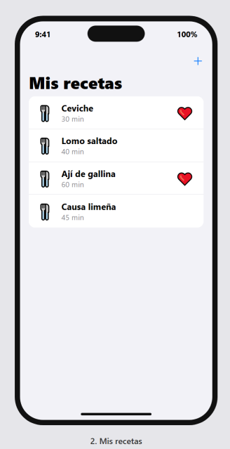
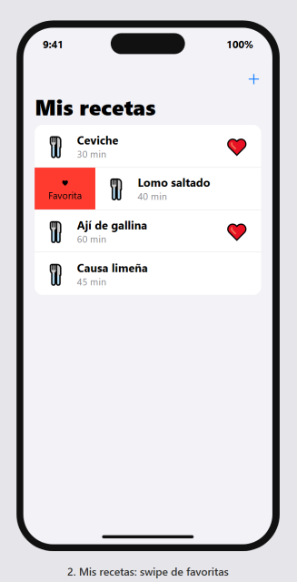
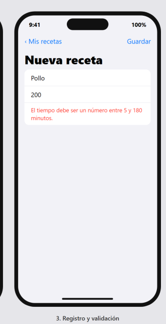

# Primera Evaluación (T1) – Recetas App

[](https://github.com/Crismandev/DAM-2/actions/workflows/compilar.yml)

Proyecto desarrollado para la **Primera Evaluación (T1)** del curso **Desarrollo de Aplicaciones Móviles II** en **CIBERTEC**.

---

## 📱 Descripción de la aplicación

**Recetas App** es una aplicación desarrollada en **Swift** y **SwiftUI** (iOS 17+) que permite gestionar una lista de recetas de cocina y marcar/desmarcar recetas favoritas.

Cumple estrictamente con las consideraciones del examen:
- Uso de **`@State`** y **`@Binding`** sin `ViewModel`.
- Navegación estructurada moderna con **`NavigationStack`** y cierre por código con **`dismiss`**.
- Gestión de colecciones en memoria con tipo valor (`struct`) e identificadores únicos (`UUID`).
- Interfaz nativa y limpia siguiendo las pautas de Human Interface Guidelines de Apple.

---

## 🎯 Rúbrica y preguntas desarrolladas (20 / 20 puntos)

| Pregunta | Criterio | Puntaje | Detalle implementado |
|---|---|:---:|---|
| **Pregunta 01** | Pantalla de Bienvenida | **04 pts** | Fondo naranja en toda la pantalla (`ignoresSafeArea`), ícono `fork.knife.circle.fill` en blanco centrado (100x100), título «Recetas App» y botón blanco con texto naranja «Ingresar». Flujo unidireccional: al ingresar no se puede volver a la bienvenida. |
| **Pregunta 02** | Pantalla Mis recetas (Listado) | **04 pts** | Barra con título «Mis recetas» y botón `+`. Lista con 4 recetas de ejemplo (`Ceviche`, `Lomo saltado`, `Ají de gallina`, `Causa limeña`). Cada fila muestra ícono `fork.knife`, nombre en negrita, minutos («30 min») y corazón rojo si es favorita. |
| **Pregunta 03** | Swipe de favoritas | **04 pts** | Deslizamiento hacia la derecha (`.swipeActions(edge: .leading)`). Botón rojo «Favorita» con ícono si no es favorita, o botón gris «Quitar» si ya lo es. Alterna el estado en tiempo real y muestra/oculta el corazón rojo. |
| **Pregunta 04** | Validaciones del Registro | **04 pts** | Formulario con campos de Nombre y Tiempo en minutos. Validación estricta con mensajes específicos en color rojo debajo de los campos si están vacíos, si el nombre tiene menos de 3 caracteres o si el tiempo no está entre 5 y 180 minutos. |
| **Pregunta 05** | Navegación estructurada | **04 pts** | Navegación con `NavigationStack` desde Mis recetas a Nueva receta. Al completar los datos válidos, la receta se añade a la lista y se realiza `dismiss()` automático por código regresando al listado. |

---

## 🗂 Estructura del proyecto

```text
RecetasApp/
├── RecetasApp.xcodeproj/               # Configuración del proyecto Xcode (iOS 17+)
├── RecetasApp/
│   ├── RecetasAppApp.swift             # Punto de entrada de la aplicación (@main)
│   ├── ContentView.swift               # Conmutador reactivo entre Bienvenida y Mis recetas
│   ├── Assets.xcassets/                # Íconos y paleta de colores de la app
│   ├── Modelo/
│   │   └── Receta.swift                # Struct Identifiable y datos iniciales de ejemplo
│   └── Vistas/
│       ├── BienvenidaView.swift        # Pantalla 1: Bienvenida
│       ├── MisRecetasView.swift        # Pantalla 2: Listado y swipe de favoritas
│       ├── FilaReceta.swift            # Componente reutilizable para cada ítem de receta
│       └── RegistroView.swift          # Pantalla 3: Formulario con validaciones y dismiss
├── RecetasAppUITests/
│   └── CapturasUITests.swift           # Suite de UI Tests automatizados para recorrido completo
├── capturas/                           # Prototipo visual de las pantallas de la app
├── SUSTENTACION.md                     # Guía completa con preguntas resueltas para sustentación
└── README.md                           # Documentación principal del repositorio
```

---

## 🧭 Flujo de navegación

```text
[BienvenidaView] ──(Botón "Ingresar")──▶ [MisRecetasView] ──(Botón "+")──▶ [RegistroView]
                                                ▲                                  │
                                                └──── Botón "Guardar" (dismiss) ───┘
```

1. **Bienvenida**: se muestra al abrir la app. Al pulsar «Ingresar», `mostrarMisRecetas` pasa a `true` y se destruye la vista de Bienvenida, por lo que no es posible volver a ella.
2. **Mis recetas**: pantalla principal con la lista de recetas en memoria.
3. **Nueva receta**: se apila sobre el `NavigationStack`. Al guardar satisfactoriamente, se invoca `dismiss()` y se extrae de la pila.

---

## 🎨 Prototipo de la aplicación

<table>
<tr>
<td align="center" valign="top">
  <br>
  <b>1. Bienvenida</b><br>
  <sub>P01: Fondo naranja, tenedor/cuchillo, botón Ingresar</sub>
</td>
<td align="center" valign="top">
  <br>
  <b>2. Mis recetas</b><br>
  <sub>P02: 4 recetas de ejemplo y corazón en favoritas</sub>
</td>
<td align="center" valign="top">
  <br>
  <b>3. Swipe favoritas</b><br>
  <sub>P03: Deslizar a la derecha para marcar o quitar</sub>
</td>
<td align="center" valign="top">
  <br>
  <b>4. Registro y validación</b><br>
  <sub>P04 y P05: Reglas de validación y dismiss</sub>
</td>
</tr>
</table>

---

## 🔍 Reglas de validación implementadas

| # | Regla evaluada | Mensaje de error mostrado (en rojo) |
|---|---|---|
| 1 | Campo Nombre vacío | `«Ingrese el nombre de la receta.»` |
| 2 | Campo Tiempo vacío | `«Ingrese el tiempo de preparación.»` |
| 3 | Nombre con menos de 3 caracteres | `«El nombre debe tener al menos 3 caracteres.»` |
| 4 | Tiempo fuera del rango (menor a 5 o mayor a 180 min, o no numérico) | `«El tiempo debe ser un número entre 5 y 180 minutos.»` |

---

## 🚀 Cómo ejecutar el proyecto

1. Clona el repositorio:
   ```bash
   git clone https://github.com/Crismandev/DAM-2.git
   ```
2. Abre la carpeta del proyecto en macOS:
   ```bash
   open RecetasApp/RecetasApp.xcodeproj
   ```
3. Selecciona cualquier simulador de iOS (ej: iPhone 16 con iOS 17 o 18) en la barra superior de Xcode.
4. Presiona **⌘ + R** para compilar y ejecutar en el simulador.

---

## 🎓 Preparación para la sustentación oral

Para repasar y sustentar tu código frente al docente, consulta la guía detallada:
👉 **[SUSTENTACION.md](SUSTENTACION.md)** (incluye preguntas sobre `@State`, `@Binding`, `dismiss`, búsqueda por UUID y ciclo de vida de vistas).
